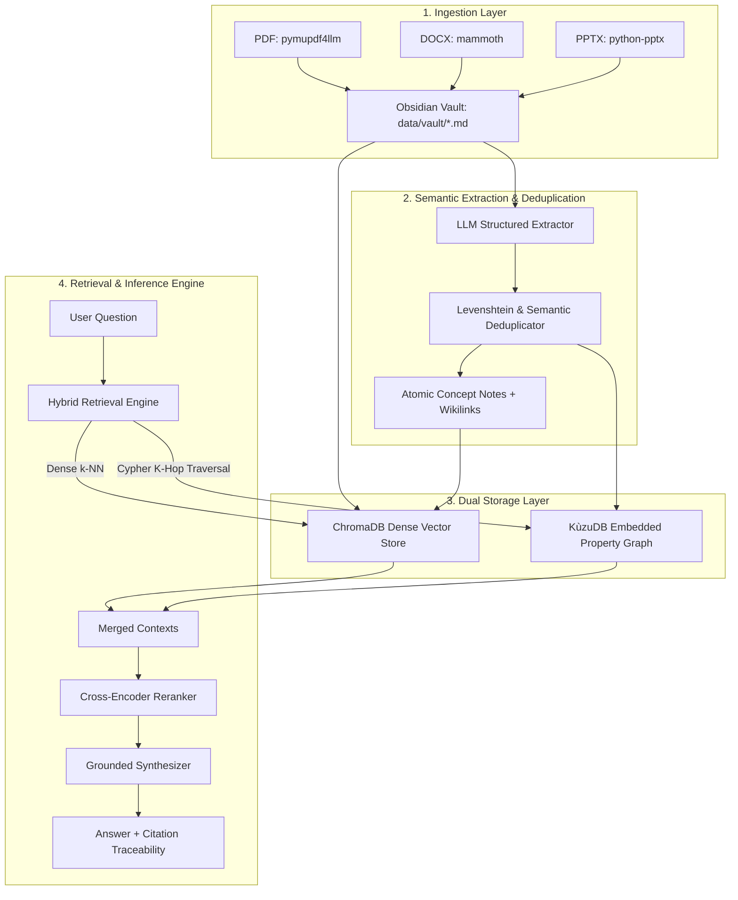

# 🧠 GraphRAG Corporate Brain

Production-grade, modular GraphRAG (Knowledge Graph + Retrieval-Augmented Generation) pipeline in Python.

It ingests multi-format enterprise files (**PDF**, **DOCX**, **PPTX**), converts them into an **Obsidian-compatible Markdown Knowledge Vault** with YAML frontmatter and bidirectional wikilinks (`[[TargetEntity|RELATION_TYPE]]`), extracts structured ontologies, deduplicates entities, stores them in an embedded C++ property graph (**KùzuDB**) and dense vector index (**ChromaDB**), and performs multi-hop hybrid retrieval with cross-encoder re-ranking.

---

## 🏗️ System Architecture



---

## 🛠️ Technical Stack

- **Multi-Format Ingestion:** `pymupdf4llm` (PDF layout-aware markdown & tables), `mammoth` (DOCX semantic markdown), `python-pptx` (PPTX slide hierarchy & speaker notes).
- **Knowledge Vault:** Obsidian-compatible markdown format with YAML frontmatter and `[[TargetEntity|RELATION_TYPE]]` wikilinks.
- **Structured Extraction:** `pydantic`, `openai`, `pydantic-settings`.
- **Entity Resolution:** `Levenshtein` fuzzy matching + semantic similarity clustering.
- **Embedded Graph DB:** `kuzudb` (ultra-fast embedded C++ graph database with Cypher query support).
- **Vector DB:** `chromadb` (dense vector storage for document text chunks and concept summaries).
- **Re-ranking:** `sentence-transformers` cross-encoders.
- **CLI & UI:** `typer`, `rich`.

---

## 📁 Project Structure

```text
graphrag-corporate-brain/
├── data/
│   ├── raw/                # Input PDF, DOCX, PPTX files
│   └── vault/              # Obsidian-compatible Markdown Knowledge Vault (.md)
├── src/
│   ├── __init__.py
│   ├── config.py           # Pydantic-settings configuration & paths
│   ├── ingest/
│   │   ├── __init__.py
│   │   ├── pdf_parser.py   # PDF layout-aware parser
│   │   ├── docx_parser.py  # DOCX semantic markdown parser
│   │   ├── pptx_parser.py  # PPTX slide & speaker notes parser
│   │   └── pipeline.py     # Document ingest orchestrator
│   ├── graph/
│   │   ├── __init__.py
│   │   ├── schema.py       # Pydantic models for Entities and Relations
│   │   ├── extractor.py    # LLM Structured extraction pipeline
│   │   ├── deduplication.py# Fuzzy & semantic entity deduplication
│   │   └── kuzu_store.py   # KùzuDB C++ graph database & Cypher manager
│   ├── vector/
│   │   ├── __init__.py
│   │   └── vector_store.py # ChromaDB dense vector store manager
│   ├── retrieval/
│   │   ├── __init__.py
│   │   ├── hybrid_engine.py# Vector k-NN + Cypher K-hop fusion retriever
│   │   └── reranker.py     # Cross-Encoder Re-ranker module
│   └── generator/
│       ├── __init__.py
│       └── synthesizer.py  # Grounded answer synthesis with citations
├── tests/
│   ├── test_ingest.py
│   ├── test_graph.py
│   ├── test_vector.py
│   └── test_retrieval.py
├── .env.example
├── .gitignore
├── requirements.txt
├── README.md
└── main.py                 # Rich CLI interface for ingest, index, query, stats
```

---

## 🚀 Quick Start Guide

### 1. Installation

Clone the repository and install dependencies:

```bash
git clone https://github.com/DelgadoCristobal/graphrag-corporate-brain.git
cd graphrag-corporate-brain
pip install -r requirements.txt
```

### 2. Environment Setup

Copy `.env.example` to `.env` and set your OpenAI API key (optional if using local heuristics):

```bash
cp .env.example .env
```

### 3. Usage Commands

#### Step A: Ingest Documents into Obsidian Vault
Place your enterprise documents (`.pdf`, `.docx`, `.pptx`) inside `data/raw/` and run:

```bash
python main.py ingest
```

#### Step B: Build Knowledge Graph & Vector Index
Extract ontologies, resolve duplicate entities, and store into KùzuDB and ChromaDB:

```bash
python main.py index
```

#### Step C: Hybrid Multi-Hop Retrieval & Synthesis
Query your corporate brain using hybrid graph + vector search:

```bash
python main.py query "How does Project Alpha depend on the AI infrastructure?"
```

#### Step D: View Knowledge Base Statistics

```bash
python main.py stats
```

---

## 🧪 Running Tests

Execute the automated test suite with pytest:

```bash
pytest tests/
```

---

## 📄 License

MIT License.
